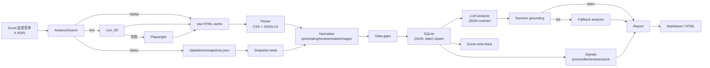

# 架构白板

## 数据流



## 组件职责

| 组件 | 职责 | 不负责 |
| --- | --- | --- |
| `sources/amazon.py` | 请求、限速、重试、缓存、CAPTCHA 检测 | 字段解释 |
| `parse.py` | CSS/JSON-LD 抽字段、selector hits | 趋势分析 |
| `normalize.py` | 价格/星级/评价/销量/图片口径、缺口 | 页面请求 |
| `excel_io.py` | 读 watchlist、历史导入、回写 | 抓取 |
| `store.py` | SQLite schema、Upsert、run log | 业务判断 |
| `signals.py` | 确定性业务信号 | 自然语言 |
| `llm.py` | LLM 调用、JSON 契约、降级 | 产生数字 |
| `llm_guard.py` | 数字 grounding | 改写模型输出 |
| `report.py` | Markdown/HTML 渲染 | 数据采集 |

## 数据模型

```text
products(product_id=ASIN, name, category, url, marketplace, excel_sheet)
snapshots(product_id, snapshot_date, price, list_price, rating, reviews,
          sales_value, sales_text, bullets, description, images, seller,
          data_gaps, selector_hits)
analyses(product_id, snapshot_date, summary, trends, changes, actions, confidence)
run_logs(run_id, source, success/skipped/failed/blocked/cache_hits, details)
```

唯一键：`(product_id, snapshot_date)`；同一天重跑 Upsert。

## 运行模式

| 模式 | 用途 | 依赖 |
| --- | --- | --- |
| `live` | 真实采集 | 网络；价格受地区/代理影响 |
| `replay` | 用缓存 HTML 重跑 | 本地 `data/raw` |
| `demo` | 作品集离线演示 | committed `data/demo/snapshots.json` |

## 失败路径

```text
fetch error      -> failed / 继续下一个商品
CAPTCHA/block    -> blocked + 保存证据 / 不重试绕过
404/unavailable  -> skipped / 不写 Excel
parse error      -> failed / 保留 HTML 供排查
cache miss       -> skipped / 明确原因
LLM error        -> fallback / confidence=low
grounding fail   -> fallback / 记录未溯源数字
Excel write fail -> 单行失败 / 源文件默认不动
```
